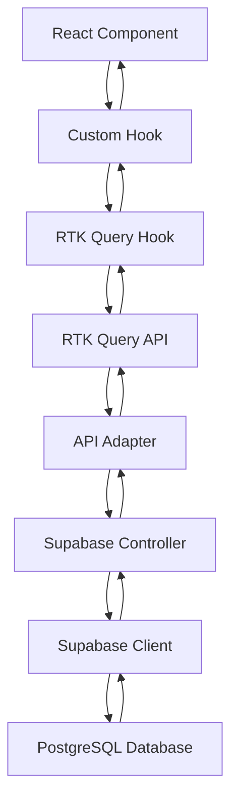
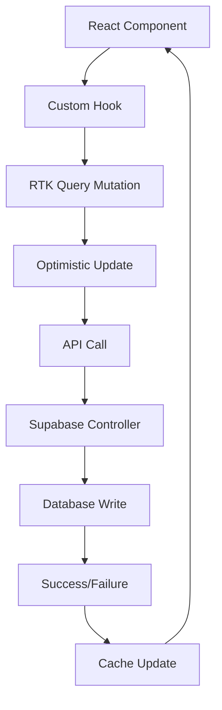

# 🏗️ Architektur & Datenfluss Dokumentation

## 📋 Inhaltsverzeichnis

1. [Übersicht](#-übersicht)
2. [Technologie-Stack](#-technologie-stack)
3. [Architektur-Schichten](#-architektur-schichten)
4. [Datenfluss](#-datenfluss)
5. [Komponenten-Architektur](#-komponenten-architektur)
6. [State Management](#-state-management)
7. [API-Architektur](#-api-architektur)
8. [Caching-Strategie](#-caching-strategie)
9. [Error Handling](#-error-handling)
10. [Performance-Optimierungen](#-performance-optimierungen)
11. [Sicherheit](#-sicherheit)
12. [Deployment](#-deployment)

---

## 🎯 Übersicht

Die ZUTATO Einkaufslisten-App folgt einer **schichtenbasierten Architektur** mit klarer Trennung der Zuständigkeiten. Das System ist auf **Skalierbarkeit**, **Wartbarkeit** und **Performance** ausgelegt.

### 🎨 Architektur-Prinzipien

- **Separation of Concerns** - Jede Schicht hat eine klare Verantwortlichkeit
- **Single Responsibility** - Jede Komponente hat eine einzige Aufgabe
- **Dependency Inversion** - Abstraktionen über konkrete Implementierungen
- **Type Safety** - Vollständige TypeScript-Unterstützung
- **Reactive Programming** - Reaktive Datenflüsse mit RTK Query

---

## 🛠️ Technologie-Stack

### Frontend
- **React 18** - UI-Framework
- **TypeScript** - Type Safety
- **Vite** - Build Tool & Dev Server
- **Tailwind CSS** - Styling
- **React Router v6** - Routing

### State Management
- **Redux Toolkit** - Global State Management
- **RTK Query** - Server State Management & Caching
- **React Redux** - React Integration

### Backend & Database
- **Supabase** - Backend-as-a-Service
- **PostgreSQL** - Relational Database
- **Row Level Security (RLS)** - Datenbank-Sicherheit

### PWA & Offline
- **Vite PWA Plugin** - Progressive Web App
- **Service Workers** - Offline-Funktionalität
- **IndexedDB** - Lokale Datenspeicherung

---

## 🏛️ Architektur-Schichten

```
┌─────────────────────────────────────────────────────────────┐
│                    Presentation Layer                       │
│  ┌─────────────┐ ┌─────────────┐ ┌─────────────┐           │
│  │   Pages     │ │ Components  │ │   Hooks     │           │
│  └─────────────┘ └─────────────┘ └─────────────┘           │
└─────────────────────────────────────────────────────────────┘
┌─────────────────────────────────────────────────────────────┐
│                    Business Logic Layer                     │
│  ┌─────────────┐ ┌─────────────┐ ┌─────────────┐           │
│  │   Store     │ │   Services  │ │   Utils     │           │
│  └─────────────┘ └─────────────┘ └─────────────┘           │
└─────────────────────────────────────────────────────────────┘
┌─────────────────────────────────────────────────────────────┐
│                     Data Access Layer                       │
│  ┌─────────────┐ ┌─────────────┐ ┌─────────────┐           │
│  │ RTK Query   │ │ Controllers │ │   Adapters  │           │
│  └─────────────┘ └─────────────┘ └─────────────┘           │
└─────────────────────────────────────────────────────────────┘
┌─────────────────────────────────────────────────────────────┐
│                    Infrastructure Layer                     │
│  ┌─────────────┐ ┌─────────────┐ ┌─────────────┐           │
│  │  Supabase   │ │ PostgreSQL  │ │   Auth      │           │
│  └─────────────┘ └─────────────┘ └─────────────┘           │
└─────────────────────────────────────────────────────────────┘
```

### 1. Presentation Layer
- **Pages**: Hauptseiten der Anwendung
- **Components**: Wiederverwendbare UI-Komponenten
- **Hooks**: Custom React Hooks für Business Logic

### 2. Business Logic Layer
- **Store**: Redux Store für globalen State
- **Services**: Business Logic Services
- **Utils**: Hilfsfunktionen und Utilities

### 3. Data Access Layer
- **RTK Query**: API State Management
- **Controllers**: Supabase API Controller
- **Adapters**: API Adapter für RTK Query

### 4. Infrastructure Layer
- **Supabase**: Backend-as-a-Service
- **PostgreSQL**: Datenbank
- **Auth**: Authentifizierung

---

## 🔄 Datenfluss

### Standard-Datenfluss (Read Operations)



### Beispiel: Listen laden

```typescript
// 1. Component ruft Hook auf
const { lists } = useListsRTK();

// 2. Hook ruft RTK Query auf
const { data: lists } = useGetListsQuery();

// 3. RTK Query macht API-Call
// GET /api/lists

// 4. Adapter fängt Request ab
supabaseBaseQuery({ url: '/api/lists', method: 'GET' })

// 5. Controller macht DB-Call
listsController.getLists()

// 6. Supabase Query
supabase.from('lists').select('*')

// 7. Daten fließen zurück
```

### Mutation-Datenfluss (Write Operations)



### Beispiel: Item erstellen

```typescript
// 1. Component ruft Mutation auf
const { createItem } = useShoppingItemsRTK(listId);
await createItem(itemData);

// 2. RTK Query macht Optimistic Update
onQueryStarted(itemData, { dispatch, queryFulfilled }) {
  // Item sofort zum Cache hinzufügen
  dispatch(shoppingItemsApi.util.updateQueryData(...))
}

// 3. API-Call
// POST /api/shopping-items

// 4. Database Write
supabase.from('shopping_items').insert(itemData)

// 5. Cache Update basierend auf Result
```

---

## 🧩 Komponenten-Architektur

### Komponenten-Hierarchie

```
App
├── Layout
│   ├── Header
│   ├── OfflineIndicator
│   └── PWAUpdateBanner
├── Routes
│   ├── ListsPage
│   ├── ShoppingListPage
│   ├── ProductDetailPage
│   ├── SearchPage
│   ├── CategorySelectPage
│   ├── UnitSelectPage
│   ├── LoginPage
│   └── RegisterPage
└── ProtectedRoute
```

### Komponenten-Typen

#### 1. Page Components
- **Verantwortlichkeit**: Hauptseiten der Anwendung
- **State**: Lokaler UI-State
- **Props**: Route-Parameter
- **Beispiele**: `ListsPage`, `ShoppingListPage`

#### 2. Feature Components
- **Verantwortlichkeit**: Spezifische Features
- **State**: Feature-spezifischer State
- **Props**: Feature-Daten
- **Beispiele**: `SwipeAction`, `FontAwesomeIcon`

#### 3. Layout Components
- **Verantwortlichkeit**: Layout und Navigation
- **State**: Globaler UI-State
- **Props**: Konfiguration
- **Beispiele**: `Header`, `Layout`

#### 4. Utility Components
- **Verantwortlichkeit**: Wiederverwendbare UI-Elemente
- **State**: Minimaler lokaler State
- **Props**: UI-Konfiguration
- **Beispiele**: `OfflineIndicator`, `PWAUpdateBanner`

---

## 📊 State Management

### Redux Store Struktur

```typescript
interface RootState {
  // RTK Query APIs
  listsApi: ListsApiState;
  shoppingItemsApi: ShoppingItemsApiState;
  
  // UI State
  header: HeaderState;
  events: EventsState;
  
  // Search State
  search: SearchState;
}
```

### State-Typen

#### 1. Server State (RTK Query)
```typescript
// Automatisch verwaltet von RTK Query
listsApi: {
  queries: {
    'getLists()': { data: List[], isLoading: boolean }
  },
  mutations: {
    'createList()': { isLoading: boolean }
  }
}
```

#### 2. Client State (Redux)
```typescript
// Manuell verwaltet
header: {
  title: string;
  showBack: boolean;
  background: string;
}

events: {
  filterClicked: boolean;
  backClicked: boolean;
}
```

### State-Updates

#### Optimistic Updates
```typescript
// Item sofort zum Cache hinzufügen
onQueryStarted(itemData, { dispatch }) {
  dispatch(shoppingItemsApi.util.updateQueryData(
    'getItems', 
    listId, 
    (draft) => draft.push(newItem)
  ))
}
```

#### Cache Invalidation
```typescript
// Cache automatisch invalidieren
invalidatesTags: (result, error, { listId }) => [
  { type: 'ShoppingItems', id: `list-${listId}` }
]
```

---

## 🔌 API-Architektur

### API-Schichten

```
┌─────────────────────────────────────────────────────────────┐
│                    RTK Query APIs                           │
│  ┌─────────────┐ ┌─────────────┐ ┌─────────────┐           │
│  │ listsApi    │ │shoppingItems│ │   authApi   │           │
│  └─────────────┘ └─────────────┘ └─────────────┘           │
└─────────────────────────────────────────────────────────────┘
┌─────────────────────────────────────────────────────────────┐
│                    API Adapter                              │
│  ┌─────────────┐ ┌─────────────┐ ┌─────────────┐           │
│  │ supabaseApi │ │   baseQuery │ │   adapter   │           │
│  └─────────────┘ └─────────────┘ └─────────────┘           │
└─────────────────────────────────────────────────────────────┘
┌─────────────────────────────────────────────────────────────┐
│                    Supabase Controllers                     │
│  ┌─────────────┐ ┌─────────────┐ ┌─────────────┐           │
│  │ListsController│ShoppingItems│ │ AuthService │           │
│  └─────────────┘ └─────────────┘ └─────────────┘           │
└─────────────────────────────────────────────────────────────┘
```

### RTK Query APIs

#### listsApi
```typescript
export const listsApi = createApi({
  reducerPath: 'listsApi',
  baseQuery: supabaseBaseQuery,
  tagTypes: ['List', 'ListMember'],
  endpoints: (builder) => ({
    getLists: builder.query<List[], void>({
      query: () => ({ url: '/api/lists', method: 'GET' }),
      providesTags: ['List']
    }),
    getList: builder.query<List, string>({
      query: (id) => ({ url: `/api/lists/${id}`, method: 'GET' }),
      providesTags: (result, error, id) => [{ type: 'List', id }]
    }),
    // ... weitere Endpoints
  })
})
```

#### shoppingItemsApi
```typescript
export const shoppingItemsApi = createApi({
  reducerPath: 'shoppingItemsApi',
  baseQuery: supabaseBaseQuery,
  tagTypes: ['ShoppingItem'],
  endpoints: (builder) => ({
    getItems: builder.query<ShoppingItem[], string>({
      query: (listId) => ({ 
        url: `/api/shopping-items/${listId}`, 
        method: 'GET' 
      }),
      providesTags: (result, error, listId) => [
        { type: 'ShoppingItem', id: `list-${listId}` }
      ]
    }),
    // ... weitere Endpoints
  })
})
```

### API Adapter

#### supabaseBaseQuery
```typescript
export const supabaseBaseQuery = async (args: {
  url: string;
  method: string;
  body?: any;
  params?: any;
}) => {
  const { url, method, body, params } = args;
  
  // URL-Parsing für verschiedene Endpoints
  if (url === '/api/lists') {
    return await listsController.getLists();
  }
  
  if (url.includes('/api/shopping-items/')) {
    const listId = url.split('/')[3];
    return await shoppingItemsController.getItems(listId);
  }
  
  // ... weitere URL-Patterns
}
```

### Supabase Controllers

#### ListsController
```typescript
export class ListsController {
  async getLists(): Promise<ApiResponse<List[]>> {
    const { data, error } = await supabase
      .from('lists')
      .select('*')
      .eq('is_deleted', false);
    
    return { data, error: error?.message, status: error ? 500 : 200 };
  }
  
  // ... weitere Methoden
}
```

---

## 💾 Caching-Strategie

### RTK Query Caching

#### Cache-Konfiguration
```typescript
// Cache für 3 Minuten halten
keepUnusedDataFor: 180,

// Tags für Cache-Invalidation
providesTags: (result, error, listId) => [
  { type: 'ShoppingItem', id: `list-${listId}` }
],

// Cache invalidieren bei Mutationen
invalidatesTags: (result, error, { listId }) => [
  { type: 'ShoppingItem', id: `list-${listId}` }
]
```

#### Cache-Verhalten

1. **Automatisches Caching**: RTK Query cached alle Responses automatisch
2. **Tag-basierte Invalidation**: Cache wird basierend auf Tags invalidiert
3. **Optimistic Updates**: UI wird sofort aktualisiert, bevor Server-Response
4. **Background Refetching**: Daten werden im Hintergrund aktualisiert
5. **Cache Persistence**: Cache kann persistent gespeichert werden

### PWA Caching

#### Service Worker Caching
```typescript
// API Caching für Shopping Items
{
  urlPattern: /\/api\/shopping-items\/.*/i,
  handler: 'NetworkFirst',
  options: {
    cacheName: 'shopping-items-api-cache',
    networkTimeoutSeconds: 3,
    expiration: {
      maxEntries: 100,
      maxAgeSeconds: 60 * 60 * 24 // 24 Stunden
    }
  }
}
```

---

## ⚠️ Error Handling

### Error-Hierarchie

```
┌─────────────────────────────────────────────────────────────┐
│                    UI Layer                                 │
│  ┌─────────────┐ ┌─────────────┐ ┌─────────────┐           │
│  │ Error UI    │ │ Error Toast │ │ Error Modal │           │
│  └─────────────┘ └─────────────┘ └─────────────┘           │
└─────────────────────────────────────────────────────────────┘
┌─────────────────────────────────────────────────────────────┐
│                    Hook Layer                               │
│  ┌─────────────┐ ┌─────────────┐ ┌─────────────┐           │
│  │ Error State │ │ Retry Logic │ │ Fallback    │           │
│  └─────────────┘ └─────────────┘ └─────────────┘           │
└─────────────────────────────────────────────────────────────┘
┌─────────────────────────────────────────────────────────────┐
│                    API Layer                                │
│  ┌─────────────┐ ┌─────────────┐ ┌─────────────┐           │
│  │ HTTP Errors │ │ Network     │ │ Validation  │           │
│  └─────────────┘ └─────────────┘ └─────────────┘           │
└─────────────────────────────────────────────────────────────┘
```

### Error-Typen

#### 1. Network Errors
```typescript
// RTK Query behandelt automatisch
const { data, error, isLoading } = useGetListsQuery();

if (error) {
  // Network error, timeout, etc.
  return <ErrorComponent error={error} />;
}
```

#### 2. API Errors
```typescript
// Supabase Controller Error Handling
async getLists(): Promise<ApiResponse<List[]>> {
  try {
    const { data, error } = await supabase.from('lists').select('*');
    
    if (error) {
      return { data: null, error: error.message, status: 500 };
    }
    
    return { data, error: null, status: 200 };
  } catch (error) {
    return { data: null, error: 'Internal server error', status: 500 };
  }
}
```

#### 3. Validation Errors
```typescript
// Form Validation
const validateItem = (item: CreateShoppingItemRequest) => {
  if (!item.name) {
    throw new Error('Name is required');
  }
  if (!item.listId) {
    throw new Error('List ID is required');
  }
};
```

### Error Recovery

#### 1. Automatic Retry
```typescript
// RTK Query retry automatisch
const { data, error, refetch } = useGetListsQuery(undefined, {
  retry: 3,
  retryDelay: 1000
});
```

#### 2. Manual Retry
```typescript
// Benutzer kann manuell retry
if (error) {
  return (
    <div>
      <p>Error: {error.message}</p>
      <button onClick={refetch}>Retry</button>
    </div>
  );
}
```

#### 3. Fallback Data
```typescript
// Fallback zu cached data
const { data: lists = [] } = useGetListsQuery(undefined, {
  keepUnusedDataFor: 300 // 5 Minuten
});
```

---

## ⚡ Performance-Optimierungen

### React Optimizations

#### 1. Memoization
```typescript
// Komponenten memoizen
const ShoppingListPage = React.memo(() => {
  // Component logic
});

// Callbacks memoizen
const handleToggleCompletion = useCallback((itemId: string) => {
  toggleItemCompletion(itemId);
}, [toggleItemCompletion]);
```

#### 2. Lazy Loading
```typescript
// Code Splitting
const ProductDetailPage = lazy(() => import('./ProductDetailPage'));

// Route-based Code Splitting
<Route path="/product" element={
  <Suspense fallback={<LoadingSpinner />}>
    <ProductDetailPage />
  </Suspense>
} />
```

### RTK Query Optimizations

#### 1. Selective Queries
```typescript
// Nur benötigte Felder laden
const { data: list } = useGetListQuery(listId, {
  selectFromResult: ({ data }) => ({
    data: data ? { id: data.id, name: data.name } : undefined
  })
});
```

#### 2. Optimistic Updates
```typescript
// UI sofort aktualisieren
onQueryStarted(itemData, { dispatch }) {
  dispatch(shoppingItemsApi.util.updateQueryData(
    'getItems', 
    listId, 
    (draft) => draft.push(newItem)
  ))
}
```

#### 3. Background Updates
```typescript
// Daten im Hintergrund aktualisieren
const { data } = useGetListsQuery(undefined, {
  pollingInterval: 30000, // Alle 30 Sekunden
  refetchOnMountOrArgChange: true
});
```

### Bundle Optimizations

#### 1. Tree Shaking
```typescript
// Nur benötigte Icons importieren
import { faHome, faUser } from '@fortawesome/free-solid-svg-icons';
```

#### 2. Dynamic Imports
```typescript
// Icons dynamisch laden
const FontAwesomeIcon = lazy(() => import('./FontAwesomeIcon'));
```

---

## 🔒 Sicherheit

### Authentication

#### 1. Supabase Auth
```typescript
// JWT-basierte Authentifizierung
const { data: { user } } = await supabase.auth.getUser();

if (!user) {
  // Redirect to login
  navigate('/login');
}
```

#### 2. Protected Routes
```typescript
// Route Protection
const ProtectedRoute = ({ children }: { children: React.ReactNode }) => {
  const { user } = useAuth();
  
  if (!user) {
    return <Navigate to="/login" replace />;
  }
  
  return <>{children}</>;
};
```

### Authorization

#### 1. Row Level Security (RLS)
```sql
-- Nur Listen-Mitglieder können Items sehen
CREATE POLICY "Users can view items in their lists" ON shopping_items
FOR SELECT USING (
  list_id IN (
    SELECT list_id FROM list_members 
    WHERE user_id = auth.uid()
  )
);
```

#### 2. API-Level Authorization
```typescript
// Controller prüft Berechtigung
async getItems(listId: string): Promise<ApiResponse<ShoppingItem[]>> {
  const { data: { user } } = await supabase.auth.getUser();
  
  if (!user) {
    return { data: null, error: 'Unauthorized', status: 401 };
  }
  
  // Prüfe ob User Mitglied der Liste ist
  const { data: membership } = await supabase
    .from('list_members')
    .select('*')
    .eq('list_id', listId)
    .eq('user_id', user.id)
    .single();
    
  if (!membership) {
    return { data: null, error: 'Forbidden', status: 403 };
  }
  
  // Lade Items
  const { data, error } = await supabase
    .from('shopping_items')
    .select('*')
    .eq('list_id', listId);
    
  return { data, error: error?.message, status: error ? 500 : 200 };
}
```

### Data Validation

#### 1. Input Validation
```typescript
// TypeScript Interfaces
interface CreateShoppingItemRequest {
  name: string;
  category_id: string;
  listId: string;
  addedBy: string;
}

// Runtime Validation
const validateItem = (item: CreateShoppingItemRequest) => {
  if (!item.name?.trim()) {
    throw new Error('Name is required');
  }
  if (!item.listId) {
    throw new Error('List ID is required');
  }
};
```

#### 2. SQL Injection Prevention
```typescript
// Supabase verhindert automatisch SQL Injection
const { data } = await supabase
  .from('shopping_items')
  .select('*')
  .eq('list_id', listId) // Parameterized query
  .ilike('name', `%${query}%`); // Safe LIKE query
```

---

## 🚀 Deployment

### Build Process

#### 1. Development Build
```bash
npm run dev
# Vite Dev Server mit HMR
```

#### 2. Production Build
```bash
npm run build
# Optimized production build
```

#### 3. Preview Build
```bash
npm run preview
# Local production preview
```

### Environment Configuration

#### 1. Development
```env
# .env.development
VITE_SUPABASE_URL=http://127.0.0.1:54321
VITE_SUPABASE_ANON_KEY=your-dev-anon-key
VITE_APP_ENV=development
```

#### 2. Production
```env
# .env.production
VITE_SUPABASE_URL=https://your-project.supabase.co
VITE_SUPABASE_ANON_KEY=your-prod-anon-key
VITE_APP_ENV=production
```

### PWA Configuration

#### 1. Service Worker
```typescript
// Service Worker für Offline-Funktionalität
workbox: {
  globPatterns: ['**/*.{js,css,html,ico,png,svg,woff2}'],
  runtimeCaching: [
    // API Caching
    {
      urlPattern: /\/api\/shopping-items\/.*/i,
      handler: 'NetworkFirst',
      options: {
        cacheName: 'shopping-items-api-cache',
        networkTimeoutSeconds: 3
      }
    }
  ]
}
```

#### 2. Manifest
```json
{
  "name": "ZUTATO - Einkaufsliste",
  "short_name": "ZUTATO",
  "description": "Deine intelligente Einkaufsliste für den Haushalt",
  "theme_color": "#fbbf24",
  "background_color": "#000000",
  "display": "standalone",
  "orientation": "portrait-primary"
}
```

---

## 📈 Monitoring & Debugging

### Development Tools

#### 1. Redux DevTools
```typescript
// Redux DevTools Integration
const store = configureStore({
  reducer: rootReducer,
  middleware: (getDefaultMiddleware) =>
    getDefaultMiddleware().concat(
      listsApi.middleware,
      shoppingItemsApi.middleware
    ),
  devTools: process.env.NODE_ENV !== 'production'
});
```

#### 2. React DevTools
- Component Tree Inspection
- Props & State Debugging
- Performance Profiling

#### 3. Network Tab
- API Request Monitoring
- Response Time Analysis
- Error Tracking

### Logging

#### 1. Structured Logging
```typescript
// Environment-aware logging
export const logInfo = (message: string, data?: any) => {
  if (process.env.NODE_ENV === 'development') {
    console.log(`ℹ️ [INFO] ${message}`, data);
  }
};

export const logError = (message: string, error?: any) => {
  if (process.env.NODE_ENV === 'development') {
    console.error(`❌ [ERROR] ${message}`, error);
  }
};
```

#### 2. RTK Query Logging
```typescript
// Query lifecycle logging
async onQueryStarted({ listId, category_id }, { queryFulfilled }) {
  console.log(`🔄 [RTK Query] Starting query for category: ${category_id}`);
  
  try {
    const { data } = await queryFulfilled;
    console.log(`✅ [RTK Query] Successfully loaded ${data.length} items`);
  } catch (error) {
    console.error(`❌ [RTK Query] Failed to load items`, error);
  }
}
```

---

## 🔮 Zukunft & Erweiterungen

### Geplante Features

1. **Real-time Collaboration** - Live-Updates zwischen Benutzern
2. **Offline-First** - Vollständige Offline-Funktionalität
3. **Push Notifications** - Benachrichtigungen für Änderungen
4. **Advanced Analytics** - Einkaufsverhalten-Analyse
5. **AI Integration** - Intelligente Produktvorschläge

### Architektur-Erweiterungen

1. **Microservices** - Aufteilung in kleinere Services
2. **GraphQL** - Flexiblere API-Abfragen
3. **Event Sourcing** - Vollständige Audit-Trail
4. **CQRS** - Command Query Responsibility Segregation

---

## 📚 Weitere Dokumentation

- [RTK Query Implementation](./RTK_QUERY_IMPLEMENTATION.md)
- [PWA Setup](./PWA_README.md)
- [FontAwesome Integration](./FONTAWESOME_README.md)
- [Supabase Setup](./SUPABASE_SETUP.md)

---

*Diese Dokumentation wird kontinuierlich aktualisiert und erweitert.* 